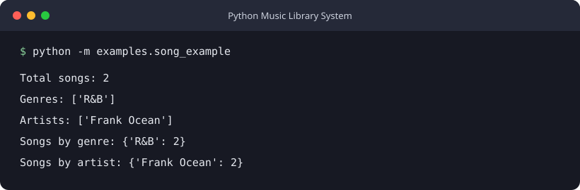

# Python Music Library System

A small Python project for practicing classes, class attributes, and class methods. Each `Song` object stores a song's name, artist, and genre. The `Song` class also tracks library-wide totals and unique artists and genres.

## Features

- Stores a song's `name`, `artist`, and `genre`.
- Tracks the total number of songs.
- Keeps unique lists of genres and artists.
- Counts songs per genre and artist.
- Updates the aggregates whenever a song is created.

The aggregate data is held in memory on the `Song` class; it is not saved between program runs.

## Requirements

- Python 3.8.13 (the version specified by `Pipfile`)
- Pipenv

Install the locked project dependencies:

```bash
pipenv install --dev
```

## Usage

Run the example from the repository root:

```python
python -m examples.song_example
```

The example is in [`examples/song_example.py`](examples/song_example.py). It produces:

```text
Total songs: 2
Genres: ['R&B']
Artists: ['Frank Ocean']
Songs by genre: {'R&B': 2}
Songs by artist: {'Frank Ocean': 2}
```



## Tests

Run the test suite from the repository root:

```bash
pipenv run pytest
```

## Project layout

- `lib/song.py` - `Song` class and its in-memory aggregates.
- `lib/testing/song_test.py` - tests for song attributes and aggregate counts.
